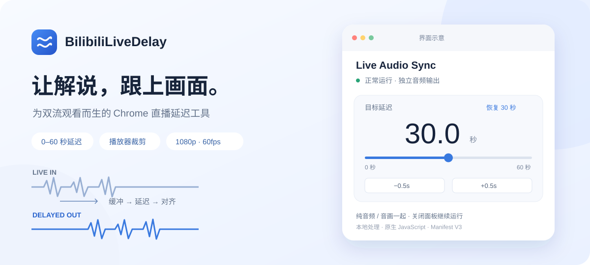
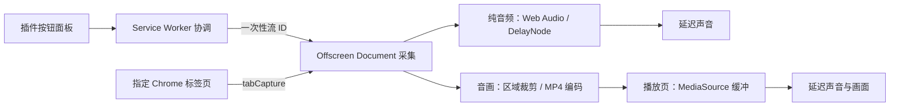

<div align="center">



# BilibiliLiveDelay

**让直播解说，跟上你正在看的画面。**

独立延迟 Chrome 标签页的声音，或同时延迟播放器画面与声音。
专为 F1 双流观看场景制作，也适用于其他网页直播。

[](manifest.json)
[](#quick-start)
[](manifest.json)
[](LICENSE)

[快速安装](#quick-start) · [功能](#features) · [工作原理](#how-it-works) · [测试记录](TESTING.md) · [反馈问题](https://github.com/Aurxs/BilibiliLiveDelay/issues)

<sub>Native JavaScript · No build step · Audio and video processed on your device</sub>

</div>

---

## 为什么做这个工具？

你在 Safari 看 F1 官方纯净流，在 Chrome 听 B 站中文解说，却发现解说比画面快了半分钟：刚准备看超车，结果已经被提前说出来了。

**BilibiliLiveDelay 把更快的那一路延后。** 默认延迟 30 秒，从插件按钮随时微调，让解说与比赛画面对齐。

它通过 Chrome 官方标签页捕获 API 获取浏览器输出，在扩展内部完成缓冲与播放。直播网页继续按自己的逻辑拉流和播放，插件不控制 B 站播放器，也不解析直播地址。

> 当前版本：**1.3.0**。已在 macOS + Chrome 的 B 站真实直播中做短时验证。完整 1～3 小时观看、最终裁剪链路的端到端音画同步仍待验证，详见 [测试记录](TESTING.md)。

<a id="features"></a>

## 功能一览

| 功能 | 你可以做什么 |
| --- | --- |
| 🎧 纯音频延迟 | 保持 Chrome 原视频播放，只延后声音，与另一浏览器画面对齐 |
| 🎬 音画一起延迟 | 在扩展播放页观看延后的声音与画面，支持全屏 |
| ✂️ 播放器区域裁剪 | 自动定位可见播放器，排除网页导航和聊天区；也可手动框选 |
| ⏱️ 0～60 秒 | 默认 30 秒，0.1 秒设置步进，支持 ±0.5 秒快捷微调 |
| 🔊 调节时保持正常音调 | 增加延迟暂停输出并倒计时恢复；减少延迟跳过已有缓冲 |
| 🖥️ 四档目标画质 | 720p/30、720p/60、1080p/30、1080p/60 |
| 🪟 工具栏控制面板 | 点击插件按钮调节；关闭面板后继续运行 |
| 🔒 本地处理 | 无服务器、账号、遥测或云端音视频上传 |

原生 JavaScript、HTML、CSS。**运行时无第三方依赖，无需构建。**

<a id="quick-start"></a>

## 快速安装

### 1. 下载代码

```bash
git clone https://github.com/Aurxs/BilibiliLiveDelay.git
```

也可以在仓库右上方选择 **Code → Download ZIP**，下载后解压。

### 2. 加载到 Chrome

1. 使用 **Chrome 116+**，打开 `chrome://extensions`。
2. 开启右上角的「开发者模式」。
3. 点击「加载已解压的扩展程序」，选择包含 `manifest.json` 的 **BilibiliLiveDelay 项目文件夹**。
4. 在工具栏扩展菜单中固定 **Live Audio Sync · 直播音画延迟**。

完成。安装无需 Node.js，也无需启动服务器。

> 仓库名是 **BilibiliLiveDelay**；Chrome 中的扩展名称仍为 **Live Audio Sync**。目前通过开发者模式安装，尚未发布到 Chrome 应用商店。Chrome 116 是基础 API 的最低版本；音画模式还需要浏览器支持相应的捕获、编码与播放能力。

## 使用：F1 双流同步

### 只延迟中文解说

```text
Safari：F1 官方画面 ──────────────────→ 你看到的比赛
Chrome：B 站中文解说 → 缓冲 30 秒 ────→ 你听到的解说
```

1. 在 Safari 播放纯净流，在 Chrome 打开正常播放的 B 站直播间。
2. **在 B 站直播标签页点击插件图标**，选择「纯音频」。
3. 设为 **30.0 秒**，点击「开始延迟」。初次启动需等待缓冲。
4. 听到延迟后的解说时，用 `−0.5s` / `+0.5s` 微调，与 Safari 画面对齐。
5. 点击「停止延迟」释放采集、丢弃剩余缓冲，恢复网页当前时刻的声音。

纯音频模式不会捕获视频。Chrome 原标签页的视频继续播放，Safari 与其他未选择的标签页不在采集范围内。

### 声音与画面一起延迟

1. 在源直播网页的插件面板选择「音画一起」。
2. 选择采集范围与目标画质，点击「开始延迟」。
3. 扩展打开自己的延迟播放页，缓冲完成后开始播放。需要时点击「播放声音与画面」允许 Chrome 输出。
4. 播放页支持「全屏」，按 `Esc` 退出；延迟仍从插件按钮调整。

**关闭控制面板会继续运行；关闭或刷新延迟播放页会结束本次音画采集。** 切换模式、范围或画质，需要先停止。

### 选择采集范围

| 范围 | 适用场景 |
| --- | --- |
| **自动识别播放器** · 默认 | 最大可见播放器；B 站优先定位 `#live-player` 内的视频 |
| **手动框选** | 自动定位失败，或播放器位于跨域 iframe 内 |
| **整个标签页** | 希望保留网页整体画面 |

自动模式要求播放器完整显示在网页视口内。手动模式先点击「框选当前网页的视频区域」，在本地截图预览中拖出矩形并保存，再回到源网页开始；滚动源网页或改变窗口尺寸后需要重新框选。

**区域模式先捕获所选标签页，再裁剪视频帧并编码选中区域。** 不是直接下载直播源。播放器区域里的弹幕、控制条和遮挡也会出现在输出中。

### 延迟调节会发生什么？

| 操作 | 输出行为 |
| --- | --- |
| 30 → 35 秒 | 暂停输出约 5 秒，直播继续采集，面板显示倒计时，随后自动恢复 |
| 35 → 30 秒 | 跳过约 5 秒缓冲内容，以正常速度继续播放 |
| 拖动滑块 | 拖动时预览，松手后应用 |
| 停止后重启 | 丢弃旧缓冲，重新等待所选延迟 |

调节不使用加速追赶，因此不会通过可听见的变速造成升降调；短暂停顿、纯音频淡入淡出与内容跳过仍会发生。

## 画质与资源占用

| 目标档位 | 请求的视频目标码率 |
| --- | ---: |
| 720p / 30fps · 默认 | 4 Mbps |
| 720p / 60fps | 6 Mbps |
| 1080p / 30fps | 8 Mbps |
| 1080p / 60fps | 10 Mbps |

音频目标码率为 128 kbps。视频使用可变码率，**实际数据量可能高于请求目标**，请查看面板的「数据平均」。

- **1080p 是输出像素尺寸。** 画面经过浏览器渲染、裁剪与有损重编码，清晰度受直播源、播放器显示尺寸、Chrome 采样与设备影响。
- 初始区域像素不足时，不把小画面放大来冒充 HD；输出保持区域宽高比，尺寸可能小于档位标称值。
- **60fps 是目标档位。** 实际播放帧率单独统计；源直播的独立帧数、后台行为与设备性能都会影响结果。
- 高分辨率、高帧率与长延迟会增加 CPU/GPU、内存和耗电。遇到浏览器缓存内存上限时，扩展安全停止并提示降低画质或缩短延迟。

优先从默认档位开始，再按设备和源直播情况提高画质。30 秒音画模式会清理旧数据，通常保留约 37 秒及分块/关键帧余量；更详细的缓存策略见 [架构说明](docs/ARCHITECTURE.md)。

<a id="how-it-works"></a>

## 工作原理



Offscreen Document 承担采集和处理，控制面板关闭、Service Worker 休眠时，无需由它们维持音频。音画数据通过扩展同源通道进入自己的播放页，不经过 Service Worker 转发。

每次只处理一个标签页。启动由用户点击触发；停止、不可恢复的采集错误或目标页关闭时，释放音轨、编码器与音频资源，并提示用户重新启动。

### 权限与隐私

| 权限 | 用途 |
| --- | --- |
| `activeTab` | 用户点击图标后临时授权当前标签页 |
| `tabCapture` | 获取指定标签页的音频或音画 |
| `offscreen` | 在独立扩展文档中处理采集流 |
| `storage` | 保存设置与临时会话信息 |
| `scripting` | 只读定位播放器区域、管理定位观察器 |

没有持久的全站访问权限、网络拦截、直播请求代理或遥测。不会读取直播流地址，也不修改源播放器的 `src`、`currentTime`、`playbackRate`、`crossOrigin`、音量或静音状态。

媒体数据仅存在于运行时内存，不保存录制文件；手动框选用的截图只暂存在本地 session storage，保存或关闭选择页后清除。

## 常见问题

<details>
<summary><strong>会不会让 B 站反复切线路、转圈？</strong></summary>

扩展不会暂停源视频、重新加载播放器或修改直播请求。已完成的短时真实直播观察中，没有发现上述行为。浏览器采集也会占用资源，无法保证所有直播间与设备组合都兼容；出现异常时，先停止扩展对比源网页状态。

</details>

<details>
<summary><strong>为什么开始后暂时听不到声音？</strong></summary>

第一次启动时没有历史音频，需要等待所选延迟填满。设为 30 秒就会先等待约 30 秒；音画模式还包含编码与播放安全余量。确认网页播放器本身没有被静音。

</details>

<details>
<summary><strong>1080p 为什么可能比源网页模糊？</strong></summary>

本工具捕获浏览器呈现的画面，再进行有损编码。源直播可能是 2K，播放器区域的实际采样也可能不足 1080p。面板会分别显示可读的源尺寸、区域采样、实际输出尺寸和播放帧率，避免把档位名称当作实测结果。

</details>

<details>
<summary><strong>缓存「配额」是什么？</strong></summary>

Chrome 为媒体缓存设置的内存上限，与账号额度或流量无关。高码率和长延迟会更快达到上限。扩展会回收已播放数据；没有可回收空间仍失败时安全停止，可降低画质或缩短延迟后重新启动。

</details>

<details>
<summary><strong>音画播放页仍然静音怎么办？</strong></summary>

如果启动时源标签页被 Chrome 网站/标签页静音，音画播放页会继承该状态。需要听声音时，先取消源网站的 Chrome 静音，再停止并重新启动。插件不改变网页播放器自身的音量和静音设置。

</details>

<details>
<summary><strong>0 秒、0.1 秒精度与长期稳定性怎么理解？</strong></summary>

0.1 秒是设置步进，目标值与缓冲位置差均不是端到端测量。音画模式预留 0.75 秒播放缓冲，0 秒设置也有基础延迟；采集、编码、系统与蓝牙设备还会增加开销。系统休眠、Chrome 退出、页面丢弃会影响采集。1～3 小时耐久、设备切换与最终裁剪链路的同步仍待验证。

</details>

## 验证与开发

已完成相关回归检查、音频信号测量及 B 站真实直播短时测试。**各版本的测试结果分别记录，旧链路的测量不代表新链路已验证。** 详细步骤、实际数据与未验证项见 [TESTING.md](TESTING.md)。

最终 1.3 裁剪链路的静音实播观察：

| 项目 | 观察结果 |
| --- | --- |
| 自动播放器裁剪输出 | 实际 1920×1080 |
| 短时播放统计 | 约 54.0～59.7fps |
| 默认 30 秒下缓存范围 | 约 36.3～36.6 秒 |
| 手动框选 | 保存、启动、选中区域播放与停止流程通过 |

以上尺寸、帧率与缓存统计**不是实际延迟测量或整场稳定性保证**。

维护者可使用 Node.js 18+ 执行本地检查，无需安装依赖：

```bash
cd BilibiliLiveDelay
npm run check
npm test
```

项目提供 `test/audio-test.html` 与 `test/av-test.html`，分别生成周期性编号短音，以及同钟时间码画面与短音，便于记录目标延迟和实际输出延迟。测试 file URL 时需在扩展详情开启「允许访问文件网址」，B 站使用无需开启。

```text
BilibiliLiveDelay/
├── manifest.json                 # MV3 与权限
├── service-worker.js             # 生命周期、授权、消息协调
├── offscreen.html / offscreen.js  # 独立采集入口
├── audio-engine.js / audio-graph.js
├── av-engine.js / av-playback.js
├── player-locator.js / video-cropper.js / video-options.js
├── control.html / control.js / control.css
├── viewer.html / viewer.js / viewer.css
├── crop.html / crop.js / crop.css
├── test/                         # 手动测量页面
├── tests/                        # 聚焦行为测试
└── docs/ARCHITECTURE.md           # 架构与 API 细节
```

## 参与贡献

欢迎 [提交 Issue](https://github.com/Aurxs/BilibiliLiveDelay/issues) 或 Pull Request。报告问题时请附上 Chrome 版本、操作系统、模式/画质/目标延迟、面板错误，以及停止扩展后的源网页表现；不要提交账号凭据、Cookie 或私人直播画面。

改动请保持播放器定位只读，不引入源播放器控制或直播请求拦截，并只验证相关行为。

下一步优先做：完整比赛耐久与资源观察、最终音画同步测量、输出设备切换验证；之后考虑站点设置、快捷键和用户触发的诊断导出。

## License

[MIT](LICENSE) © Aurxs。欢迎使用、修改与贡献。

本项目是独立社区工具，与哔哩哔哩、Formula 1 及浏览器厂商无隶属关系。
